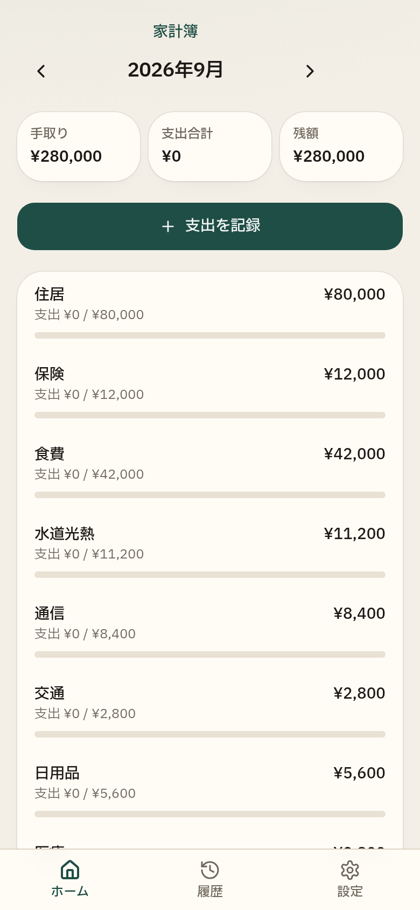

<p align="center">
  
</p>

# 家計簿

手取りから、今日使っていい金額まで。記録は分類と金額の2タップです。

[本番で開く](https://kakeibo-home.vercel.app) · [ソース](https://github.com/hiroshun99/kakeibo)

世帯と手取りを入れると、14分類の予算が自動で分かれます。住居と保険は実額、余った分は貯蓄に残します。日本語と English、円とリンギットに対応しています。

## 毎日の記録

- **すぐ記録。** 分類をタップし、金額をタップすると今日の支出になります。前回の金額が先頭に出ます。
- **レシートを分ける。** スーパーやコンビニの合計を、食費と日用品などに分けて残せます。
- **ボーナス・臨時収入。** この期間の余裕に足すか、貯蓄の目標に足すかを選べます。

## 使いすぎる前に分かる

- **今日使っていい金額**と、次の給料日までに使える金額。住居・保険・貯蓄に残す分は除きます。
- **今週の予算。** 月曜から日曜を、その期間の日数で按分します。
- **このままだと○日に残高不足。** いまのペースで自由なお金が尽きる日を出します。
- 予算の区切りは暦月か、給料日から次の給料日の前日まで。

## 来月に持ち越す

- 余った分類は次の期間に足し、使いすぎた分類は次から引きます。予算は0円より下にはしません。住居・保険・貯蓄は対象外です。
- **季節予算。** 春・夏・秋・冬だけ、水道光熱などに上乗せできます。貯蓄は変えません。

## 貯蓄と、実績からの見直し

- **貯蓄目標の予測。** 目標額を入れると、これまでの貯蓄と毎月のペースから達成日を出します。
- **実績からの提案。** 過去の支出に近づけた予算を、この期間だけ適用できます。貯蓄・住居・保険の金額はそのまま残します。
- 期間が終わると、余ったお金は貯蓄として自動で計上します。

## 気づき

- **サブスク。** 同じ名前で、近い金額が毎月続いている支払いを検出します。
- 金額が増えた店と、3ヶ月以上続いている支払いを知らせます。
- **前月比・前年同月比。** 貯蓄への移動は除いた支出です。
- **カテゴリ別の推移。** 直近6期間を棒グラフで見られます。

分類の消化が80%を超える、または日次のペースを超えると、その行が赤くなります。

## セットアップ

```bash
npm install
npm run dev
```

本番では `DATABASE_URL`（Postgres / Neon）が必要です。未設定時は埋め込み PGLite にフォールバックしますが、サーバーレス環境では永続しません。

サインインはメール＋パスワードです。確認メール用の SMTP がない環境では、確認・再設定リンクが画面内に表示されます。

## スクリプト

| コマンド | 内容 |
|---|---|
| `npm run dev` | 開発サーバー |
| `npm run build` | 本番ビルド＋マイグレーション |
| `npm run typecheck` | TypeScript 検査 |

## スタック

TanStack Start / React 19 / Tailwind v4 / Better Auth / Postgres
